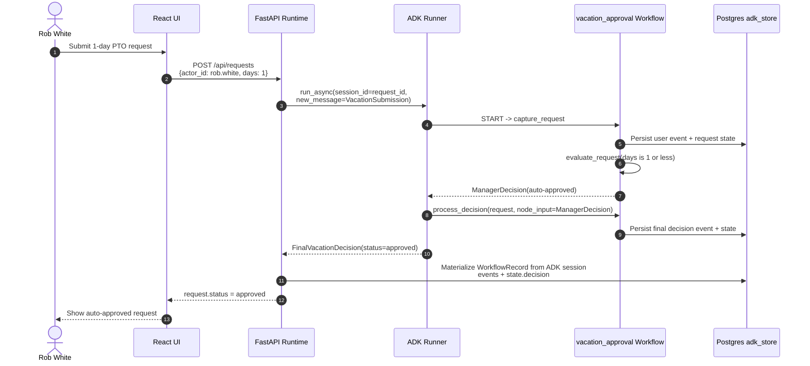
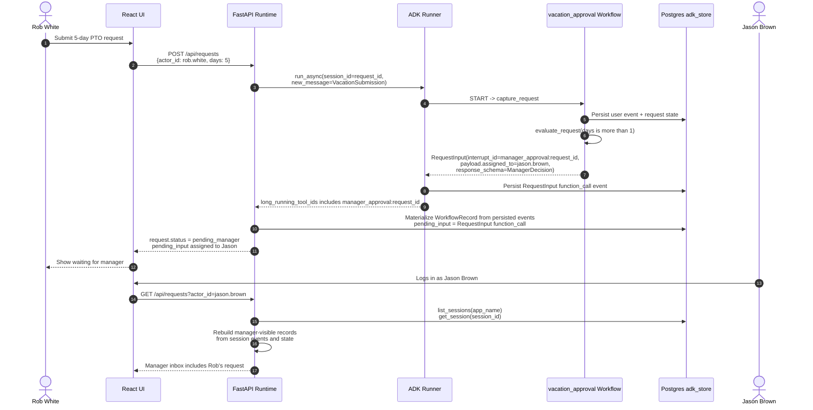
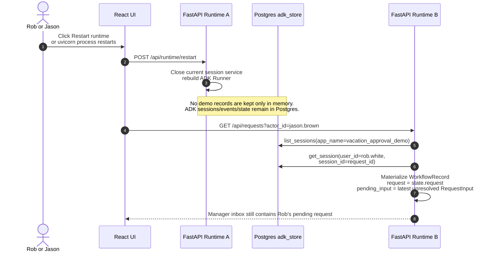
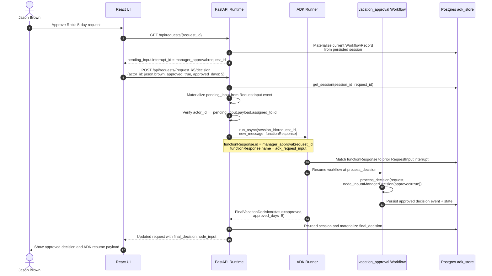
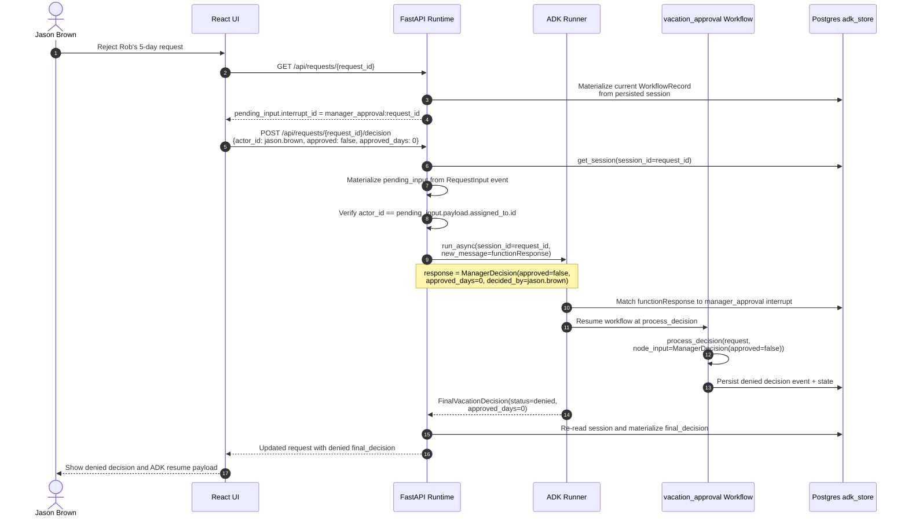

# Vacation Approval Interaction Diagrams

These diagrams show how the React UI, FastAPI runtime, ADK workflow, and
Postgres-backed ADK session store interact for the main vacation approval user
journeys.

The API does not keep vacation request records in process memory. It
materializes each visible `WorkflowRecord` from the ADK session store by reading
persisted sessions, events, state, `RequestInput` function calls, and manager
FunctionResponses.

## 1. Rob White Requests 1 Day

## 2. Rob White Requests 5 Days

## 3. Uvicorn Restart While Request Is Pending

## 4. Jason Brown Approves

## 5. Jason Brown Rejects

## Interaction Summary

The important distinction is that the manager does not start a new workflow.
Jason's UI submits a FunctionResponse that references the existing
`RequestInput.interrupt_id`. ADK uses that function response to resume the same
workflow invocation and passes the response body into `process_decision` as
`node_input`.

The second important distinction is persistence. The React UI receives
`WorkflowRecord` objects, but those are read models. They are rebuilt on demand
from ADK's Postgres-backed sessions:

- `state.request` gives the submitted vacation request.
- unresolved `adk_request_input` function calls become `pending_input`.
- user-authored `adk_request_input` FunctionResponses become resume payloads.
- `state.decision` or the final decision output gives the completed approval or
  rejection.

Because of that, a new uvicorn process can list sessions from Postgres,
materialize the same pending request, and let Jason approve or reject it after a
restart.
